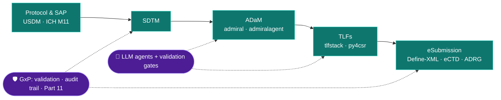

<picture>
  <source media="(prefers-color-scheme: dark)" srcset="./dist/neofetch-dark.svg">
  <source media="(prefers-color-scheme: light)" srcset="./dist/neofetch-light.svg">
  
</picture>

 

    

### Hi, I'm Jaime 👋

I lead statistical programming for clinical trials and build **open, validated tooling for clinical data science**. I care most about analytics that regulators and reviewers can trust: reproducible R and Python pipelines, CDISC-native data, and AI that runs inside the GxP boundary rather than around it.

- 🏛️ **Associate Director, Statistical Programming @ Kardigan.** I lead programming for the tonlamarsen cardiovascular program and run a 21-service governed clinical analytics platform.
- 💊 **At Merck,** I was NDA statistical programming lead for **LIPFENDRA® (enlicitide)** from Phase 2b through the pivotal CORALreef program. It was FDA-approved in July 2026.
- 🤖 I architected an enterprise **GenAI (LLM/RAG) platform**; its SAS-to-R conversion tooling was adopted organization-wide.
- 🎓 **PhD in Data Science (2026)** on AI/ML governance in clinical development. I am sole author of 4 journal papers and author of 13 PhUSE/PharmaSUG papers.
- 🔭 **Currently exploring** digital protocols with CDISC **USDM** and ICH M11 ([usdm-toolkit](https://github.com/yanmingyu92/usdm-toolkit)).

<picture>
  <source media="(prefers-color-scheme: dark)" srcset="./dist/impact-dark.svg">
  <source media="(prefers-color-scheme: light)" srcset="./dist/impact-light.svg">
  
</picture>

---

### 🧭 How I work: protocol to submission

---

### 🔬 Featured work

<table>
<tr>
<td width="33%" valign="top">

**[py4csr](https://github.com/yanmingyu92/py4csr)**
Python · MIT · on PyPI

A Python framework for clinical study reporting: CDISC-aware tables, listings and figures for CSRs.

`pip install py4csr`

</td>
<td width="33%" valign="top">

**[shiny-gxp-governance](https://github.com/yanmingyu92/shiny-gxp-governance)**
R/Shiny · MIT

A governance and validation template for R/Shiny in GxP settings: roles, control gates, risk-tiered validation, QC procedures and a 21 CFR Part 11 mapping.

</td>
<td width="33%" valign="top">

**[clinical-figure-library](https://github.com/yanmingyu92/clinical-figure-library)**
R + Python · source-available

Reproducible clinical trial figure templates (forest, waterfall, KM and more) with synthetic data and independent numerical QC. [Live gallery →](https://jaimeyan.com/lab/figures.html)

</td>
</tr>
<tr>
<td valign="top">

**[clinical-r-in-practice](https://yanmingyu92.github.io/clinical-r-in-practice/)**
Quarto book · CC BY-SA 4.0

A free 15-chapter book on the open-source R stack in regulated drug development: pharmaverse, ADaM, ARD, validation and LLM agents.

</td>
<td valign="top">

**[admiralagent](https://github.com/yanmingyu92/admiralagent)** · **[tlfstack](https://github.com/yanmingyu92/tlfstack)**
R packages · r-universe

Spec-driven ADaM code generation with LLM-translated layers, and convention-driven RTF TLFs with one code path for batch and interactive use.

</td>
<td valign="top">

**[clinprog-bench](https://github.com/yanmingyu92/clinprog-bench)** · **[CAVE-Onc](https://github.com/yanmingyu92/CAVE-Onc-Benchmark)**
Benchmarks · Python

Public benchmarks for clinical statistical-programming automation, plus graph-constrained agentic validation of CDISC oncology submissions.

</td>
</tr>
</table>

<b>More open-source work</b>

 

| Project | What it does |
|---|---|
| [rval-gateway](https://github.com/yanmingyu92/rval-gateway) | R package validation gateway: riskmetric screening, decision engine and audit chain |
| [gxp-sce](https://github.com/yanmingyu92/gxp-sce) | *The GxP Statistical Computing Environment*: a review and practitioner's guide (CC BY-SA 4.0) |
| [eSubmission-Benchmark](https://github.com/yanmingyu92/eSubmission-Benchmark) | Public benchmark submission package (SDTM, ADaM, Define-XML, TLFs) cited at PharmaSUG 2026 |
| [clinical-reporting-ir](https://github.com/yanmingyu92/clinical-reporting-ir) | Typed IR schema and parity-validation harness for the Frontiers in Pharmacology paper |
| [sop-knowledge-graph](https://github.com/yanmingyu92/sop-knowledge-graph) | Six-stage pipeline turning pharmaceutical SOPs into a knowledge graph and web explorer |
| [posit-conf-2026-bilingual](https://github.com/yanmingyu92/posit-conf-2026-bilingual) | *Modern R in Practice / 现代 R 进阶*: a 28-chapter bilingual book with companion labs |
| [usdm-toolkit](https://github.com/yanmingyu92/usdm-toolkit) | Toolchain for CDISC USDM / ICH M11 digital protocols |
| [ragql-nav](https://github.com/yanmingyu92/ragql-nav) | Multi-agent framework routing natural-language clinical data questions to SQL or Neo4j |

---

### 📄 Selected publications (sole author, 2026)

- *Workflow topology–guided skill loading for agentic AI in clinical trial data pipelines: sequential exploratory evaluation.* **JMIR Formative Research**, 2026. [doi:10.2196/100769](https://doi.org/10.2196/100769)
- *A non-destructive methodological framework for modernizing legacy clinical reporting systems for AI-driven pharmacoinformatics: a SAS case study.* **Frontiers in Pharmacology**, 2026. [doi:10.3389/fphar.2026.1876207](https://doi.org/10.3389/fphar.2026.1876207) · [code](https://github.com/yanmingyu92/clinical-reporting-ir)
- *CAVE-Onc: graph-constrained agentic validation for cross-domain contradictions in CDISC oncology submissions.* **PLOS ONE**, 2026. [doi:10.1371/journal.pone.0350376](https://doi.org/10.1371/journal.pone.0350376) · [code](https://github.com/yanmingyu92/CAVE-Onc-Benchmark)
- *ClinAgent: AI-assisted methodology for clinical trial data processing and statistical programming.* **Biology Methods and Protocols** (Oxford University Press), 2026. [doi:10.1093/biomethods/bpag032](https://doi.org/10.1093/biomethods/bpag032)

Plus 13 PhUSE / PharmaSUG conference papers (2023–2026). Full list on <a href="https://scholar.google.com/citations?user=vo1hv04AAAAJ&hl=en">Google Scholar</a>.

---

### ✍️ Latest writing

<!-- FEED:START -->
- [AI in Validated Environments: LLMs Inside the GxP Boundary](https://jaimeyan.com/blog/ai-in-validated-environments.html) · Nov 04, 2026
- [Visit Windowing, Baseline, and LOCF: The Rules That Decide BDS](https://jaimeyan.com/blog/visit-windowing-baseline-locf-guide.html) · Nov 04, 2026
- [Define-XML and the Reviewer's Guide, Explained for Programmers](https://jaimeyan.com/blog/define-xml-reviewers-guide-tutorial.html) · Oct 26, 2026
- [How to Read a Protocol and SAP as a Statistical Programmer](https://jaimeyan.com/blog/protocol-sap-reading-guide.html) · Oct 26, 2026
- [Git for SAS Programmers: Version Control in a GxP World](https://jaimeyan.com/blog/git-for-clinical-programmers.html) · Oct 06, 2026
<!-- FEED:END -->

From <a href="https://jaimeyan.com">jaimeyan.com</a>: 85+ practical articles on CDISC, R in pharma, GxP and LLM automation. <a href="https://jaimeyan.com/rss.xml">RSS</a>

---

### 🧰 Toolbox

  -0766D1?style=flat-square&logoColor=white)  

   

All demos and benchmarks use synthetic or public test data (e.g. the CDISC Pilot). Views are my own and not those of any employer.
